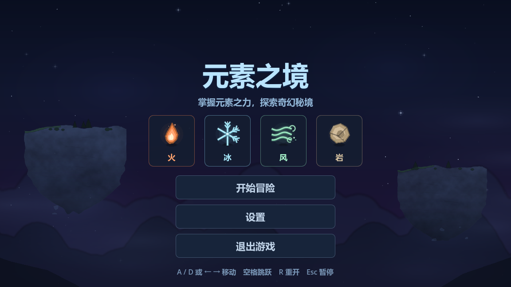
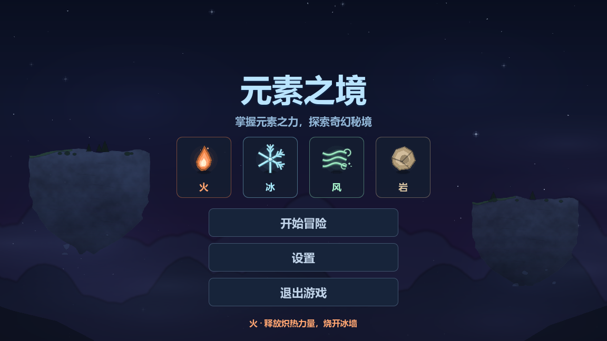
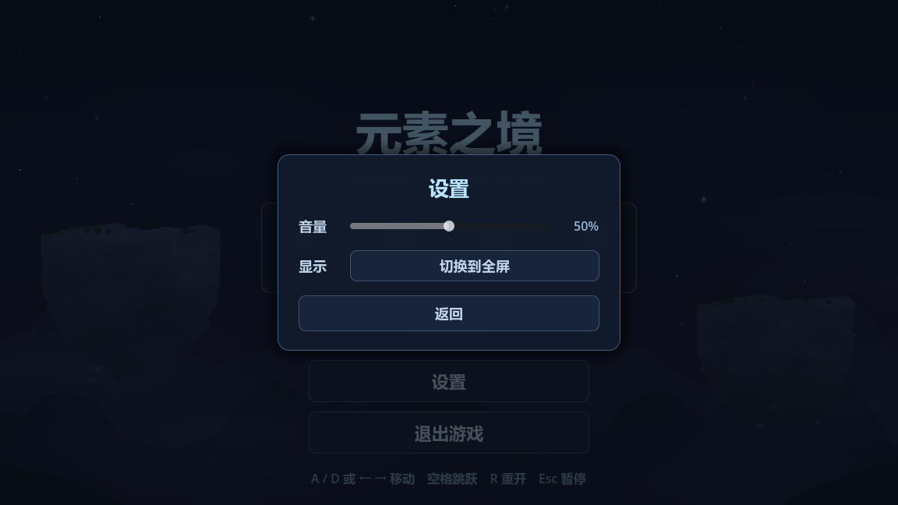
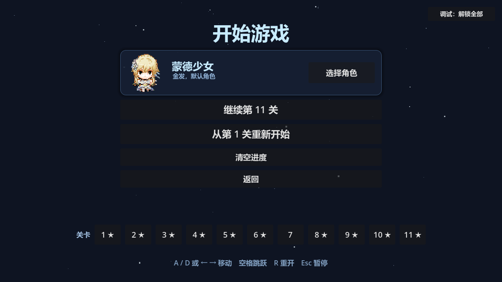
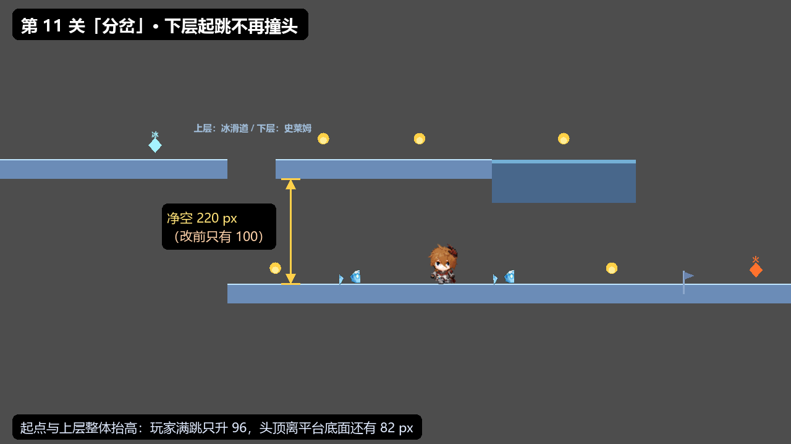
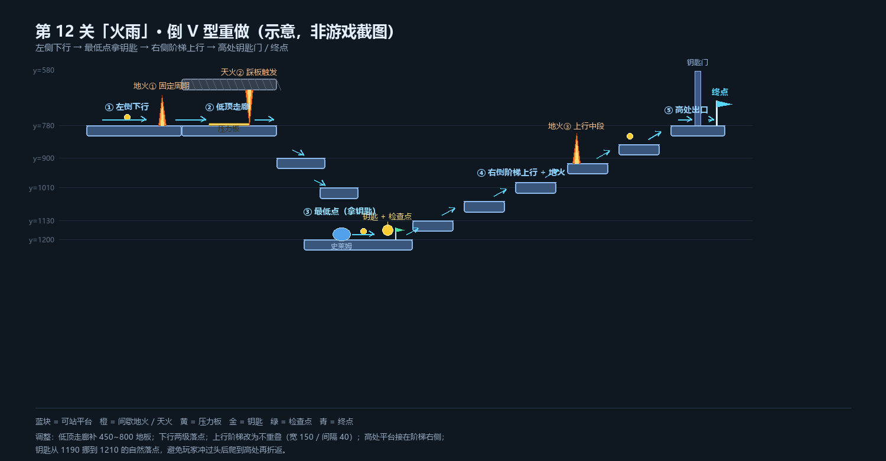

# 元素之境 — 当前进度

2D 平台跳跃小游戏 · Godot 4.7.2 · GDScript

> **一句话状态（2026-10-30 更新）**：5 关全部写完、自检和可达性检查都过了（第 4 关风场靠真人试玩）；
> 菜单是三层（元素之境 → 开始游戏 → 选择角色），角色行走图可以在选人界面换，选择存进存档。
> 主菜单这一轮按「深蓝星空 + 四元素」重做（标题、元素徽章、设置面板），背景是分层视差的
> 夜空：渐变天 + 星点 + 星云 + 两层远山 + 两座浮岛 + 云雾（浮岛和远山是预渲染 PNG）。
> 项目名也从「冰塔跳跃 Demo」改成了「元素之境」——旧存档会自动搬过来，见第五节。
>
> ⚠️ 本文第二节那张“真实能力表”是**旧版工具算错的，已废弃**：
> 旧工具把“爬到该高度的最早时刻”当成了“最晚时刻”，把能跨的距离算成了一小半。
> 修正后的数字（平跳约 146、升 30 约 134）见第二节。

---

## 一、现在能跑的

双击 `关卡检查.bat` / `自检.bat`（会自动找引擎，兼容 exe 被套在同名文件夹里的情况）：

| 检查项 | 结果 |
|---|---|
| 脚本 / 场景 / 输入映射 / 单例 / 主场景 / 角色行走图 | ✅ 全部通过 |
| 关卡 1 可达性（6/6 落脚面 + 终点可达） | ✅ 通过 |
| 第 1~5 关可达性（4 关可仿真，第 4 关风场靠真人试玩） | ✅ 通过 |

游戏本体（主菜单、HUD、暂停、通关界面、检查点、死亡重生、移动平台、闪烁平台、
按钮开门、火焰、雪粒子、程序化音效、存档）都已经写完，物理和碰撞也验证过是**真的能用**的
（冒烟测试里机器人能正常跑、跳、死、重生）。

### 菜单现在是三层

**第一层（`scenes/ui/main_menu.tscn`）**：标题「元素之境」+ 一句话副标题 + 四个元素徽章
（火 / 冰 / 风 / 岩，图标全是 `_draw()` 画的，不依赖美术资源）+ 开始冒险 / 设置 / 退出游戏。
徽章会各自上下浮动，鼠标停上去会放大、边框变亮，最底下那行提示就换成这个元素的一句说明。





「设置」是同一个场景里的浮层：音量滑块（接 `Sfx.set_volume()`）+ 全屏 / 窗口切换 + 返回，
`Esc` 也能关。没有它的时候菜单里那些按钮点了没反应，所以这块是必须的。



要改的地方：**元素名 / 说明 / 配色只在 `scripts/ui/main_menu.gd` 的 `ELEMENTS` 表里**
（`"name"` 是界面上的字，`"desc"` 是悬停那句，`"target"` 是目标色；实际显示色 =
游戏内 `Element.color_of(kind)` 往 `"target"` 混 55% 再提亮一点）；
大标题 / 副标题的字和字号在 `scenes/ui/main_menu.tscn` 的 `Title` / `Subtitle` 节点。

**背景是「渐变天空 + 星点 + 星云 + 两层远山 + 两座浮岛 + 云雾 + 前景岩壁」，分四层做鼠标视差**
（越靠近镜头动得越多），全在 `scripts/ui/menu_fx.gd`：天空渐变和星云是代码生成的，
远山和浮岛是**预渲染好的 PNG**（`scripts/ui/bg/`，`range_far/range_mid/island_a/island_b`）。

> 为什么浮岛不直接用代码画：`draw_colored_polygon` 拼出来的岛永远是"几何拼贴"感
> （试过手写轮廓、台阶、岩层线、明暗柱，都像带条纹的方窗），所以改成离线渲染贴图。
> 生成器在 `tools/gen_bg_art.py`（numpy + Pillow），改完参数跑一遍：
> ```
> python tools/gen_bg_art.py
> ```
> **重新生成后必须让 Godot 重新导入一次**，否则游戏里还是旧图（运行模式不会自己重新导入）：
> ```
> Godot --headless --path . --import
> ```
>
> 只想挪位置 / 换大小的话不用碰 Python：改 `menu_fx.gd` 顶部的 `ISLANDS` 和 `RANGES`
> 两张表（`pos` / `size` / `tint`）；星点数量在 `_build_stars()`，云和星云在
> `_build_clouds()` / `_build_nebulas()`。

> 注意菜单里岩石叫「岩」，游戏内 HUD 捡到岩石元素时仍显示「石」（`Element.name_of()` 那边的老叫法）。

**第二层（`scenes/ui/play_menu.tscn`，点「开始冒险」进来）**才是真正决定怎么玩的地方：
顶上一条全宽的「当前角色」横条（小人会播 idle 动画 + 名字 + 一句简介，右边是「选择角色」），
下面继续第 N 关 / 从第 1 关重新开始 / 清空进度 / 返回，最底下一排「关卡 1 2 3 …」可以直接跳关。



**第三层（`scenes/ui/character_select.tscn`）**是选择角色：4 个角色一人一张卡，
卡片里的小人就是游戏里真正用的那套行走图（放大了 3 倍，看清楚再选），选中亮蓝边框。


点右下角亮蓝色的「确认选择：某某」（或者按 `Enter`）才算数 —— 按下就去写存档，
写完还会从 `progress.cfg` 读回来核对一遍，读回来不一致就在顶上标红说「存档写入失败」。
`Esc` 或「返回」等于没选过（防手滑）；`←` `→` 可以左右换角色。
选中的角色 id 记在 `progress.cfg` 的 `character` 项里 —— 和关卡进度同一个存档文件，
但「清空进度」**不会**把角色换回默认（外观偏好不算进度，见第五节）。

角色表只有一份：`scripts/autoload/character_db.gd` 里的 `ROSTER`。
**改名字 / 改简介就改那一行里的 `"name"` 和 `"desc"`**（比如 `"name": "璃月少年"` → 改成你想要的名字），
改完存档不用动，界面和存档里的 id 都不受影响。界面上的大标题「选择角色」则是
`scenes/ui/character_select.tscn` 里 `Title` 节点的 `text`。
**加角色 = 把一张 576×384 的行走图丢进 `scripts/character/`，再在 `ROSTER` 里抄一段**
（`id / name / desc / sheet` 四个字段），界面和玩家会自动跟着变，别的地方一行都不用改。
一张图里其实有 4×2 = 8 个小人，想用同一张图的另一只，改 `group` / `block` 就行。

---

## 二、这一轮最重要的发现（建议先读这段）

**平台跳跃游戏最致命的 bug 不是崩溃，而是"这一关根本跳不过去"。
编辑器不会报任何错，"能加载"也不代表"能通关"。**

我这一轮犯了两次同类错误，都被工具抓出来了：

### 错误一：椭圆近似算错了跳跃能力
第一版我用 `(空隙/最远)² + (上升/摸高)² ≤ 1` 来近似判断"跳不跳得过去"，
它把"上升 60 + 空隙 80"判成了可行 —— 而物理上**永远做不到**。

### 错误二：忽略"起跳时需要助跑"
改成真实抛体仿真后，我算出来的是"起跳瞬间已经在全速"的理想值。
但实际玩的时候玩家常常从静止起跳，**够不到**。
冒烟测试里的机器人就在每一关的同一个跳点反复摔死。

### 结论：修正后的能力表（2026-10-20 更新）

起跳 `-480`、重力 `1250`、水平速度 `240`、地面加速 15 倍、下落重力 ×1.35：

| 需要的上升 | 0 | 10 | 20 | 30 | 40 | 50 | 60 | 70 | 80 | 90 |
|---|---|---|---|---|---|---|---|---|---|---|
| 能跨的最远空隙 | **146** | 142 | 138 | 134 | 129 | 124 | 118 | 111 | 103 | 89 |

> 这是“理论上限”（含 0.85 安全系数、只给 12 像素助跑）。实际设计再留余量：
> 平跳 ≤ 100、升 30 ≤ 90、升 60 ≤ 75 会比较舒服。

**旧版为什么错：**

旧工具 `_max_gap_for_rise()` 算的是“第一次到达该高度的时刻”，
那是**最早**能到的高度，不是**最晚**能落地的时间。平跳时它算到最高点就停了，
所以把 146 算成 82；升 30 时它只算到刚爬升 30 的那一瞬，把 134 算成了 14。
结论“多升 10 像素就从 82 掉到 4”是**工具 bug 的产物，不是物理规律**。

**真正要守的红线：**

- 上升 > 92（摸高）→ 跳不上去，拆台阶或用电/移动平台；
- 平台如果比脚下地面高 0~64 像素、又和可走地面重叠 → 会变成一堵墙（顶面/底边卡头）；
- 移动平台要么和地面齐平，要么高过玩家头顶 64 像素，要么不重叠；
- **有上下两层的路** → 上层平台的底面至少要比下层地面高 180 像素（碰撞盒 42 + 摸高 92，
  再加上 1.8 倍精灵的视觉高度 86 就是 178）；只有 100 的话能走不能跳，下层会撞头。
  第 9 关原先就是 100，已修正；`关卡检查.bat` 现在会为这种“低天花板”打 WARN。

---

## 三、当前状态与下一步

3 关的代码 bug 已修（移动平台原点/行程、按钮物理回调、第 3 关渡船高度）。
`关卡检查.bat` 现在检查 4 个关卡的跳跃几何、头顶净空，以及**掉落死亡区有没有盖住整关**（第 5 关"最后两块平台之间掉下去死不了"就是这条检查抓出来的：死亡区的 shape 一直停在默认的 2400 宽，关卡两端掉下去是无底洞）；**第 4 关「天空之城」是风场垂直起飞，工具不模拟，单独用真人试玩验收**；
第 1~5 关都过了自检。元素关卡（每条都对着 `scripts/levels/level_N.gd` 的 `_build()` 写，
改了关卡记得回来同步这几行）：
- 第 1 关「绿色平原」（3200 宽）：出生区 → 两个 120 的坑 → 1 只巡逻史莱姆 → 400 大坑上的横移平台
  （1900，±120）→ 钥匙 2300 / 门 2600 → 终点 2800；5 枚金币、检查点 1560。原第 1、2 关合并而来；
- 第 2 关「火雨」（2550 宽，倒 V 型一条主线）：入口地火 450（灭 2.6 / 预警 0.4 / 烧 1.0，相位 0.5）
  → 走廊 450~800（低天花板已删，可跳）→ 两级下行 → 最低点（悬空天火 1040 + 检查点 1240）
  → 5 级台阶上行（第 1、2 级接成一条，接缝有横向火；第 4 级左侧再一处地火 1905）
  → 浮台火种 1915（从第 5 级向左跳上去）→ 高处平台冰墙 2350（用火融）→ 终点 2420；3 枚金币；
- 第 3 关「分岔」（2400 宽，冰种在起点 -80）：上层起点 → 冻结水池 350~590（没冰过不去，
  掉下去会穿到下层）→ 上层平台（2 枚金币）→ 250 宽湿冰桥 950~1400（打滑，地火 1250）；
  下层 400~1400 走廊（冰霜地带 580~720 / 930~1070 + 2 只浅蓝水史莱姆 + 钥匙 880）+ 检查点 1350；
  两路在 1300~2300 汇合，钥匙门 1900 → 终点 2250；
- 第 4 关「天空之城」（2000×1800，竖向风场）：隔板 900~940 挡住直走 → 两段风场起飞
  （550~680 / 780~940，中间留缺口，缺口下面是中层悬台 680~780）→ 高台 1000~1300
  （边缘内缩 50，缩进处放 40% 微弱风场 + 金币）→ 周期风门 1320（每 6 秒吹 3 秒）
  → 逆风走廊 1340~1730（风力两倍）→ 升降台 1760~1880 下到 1120 → 下层地火 1400 + 巡逻史莱姆 1250
  → 终点 990,1120。这一关几何工具不模拟，靠真人试玩验收；
- 第 5 关「终章：元素城堡」（3400 宽）：冰种 250 → 冻结水池 450~750 → 岩石种子 900
  （地火 1000，检查点 1150）→ 300 宽断层 1290~1590：带着岩石站到 1200~1290 的岩石地面上，
  三根石柱（柱心 1335 / 1435 / 1535，柱顶 720）依次升起，踩柱过坑 → 走位史莱姆 1620 → 火种 1690
  → 检查点 1790 → 冰封水源 + 冰墙 1895（用火融）→ 蒸汽风场 1930~2096 跨过 2000~2100 的断口：
  跳进去被托起来，往右挪到 2100~2170 的悬浮台阶（顶面 415）上拿钥匙 2110,378，
  一路按右键也能活着落到对岸但拿不到钥匙 → 熔岩回廊：入口 2100~2250、地火 2200（相位 0.5）、
  下沉平台 2250~2480（顶面 840）、60 宽缺口、上层 2540~2800（顶面 780）→ 钥匙门 2900
  → 喷火史莱姆 3050 → 终点 3200；7 枚金币。

> 2026-10-30 晚：原第 5~10 关（风之丘 / 岩石矿洞 / 水之洞 / 元素回廊 / 风车 / 冰宫）整组
> 挪到同级的新项目 `..\废弃关卡`（只存档不整理），本项目里的文件已删除；原第 11 关「终章」
> 接成第 5 关，关卡内容一处没改。存档版本升到 5：旧存档只保留 1~4 关的成绩，
> 原第 11 关的成绩接到第 5 关。

> 2026-10-30：第 5 关（原第 11 关）第二个断层按参考图重做。原来它是 100 宽、原地就能跳过去的
> "装饰坑"，现在扩成 1290~1590 的 300 宽断层，必须用岩石升起三根石柱才能过
> （新机关 `scripts/elements/rock_bridge.gd`）；断层左侧留了一块特殊岩石地面，
> 玩家把 900 处拿到的岩石一路带过来，站上去就能升柱。断层前加一个检查点（1150，对岸不设），
> 第三块平台从 1300 起改成 1590 起，火/风房间整体左移 60。
> 同一天又删掉了 1100 的石墙和 1210 的第二枚岩石种子：岩石只有一枚，直接服务石柱。
> 柱心最后调成 1335 / 1435 / 1535（offsets `[45.0, 145.0, 245.0]`，柱间空隙 30 / 30、到对岸 20）。
> 当晚又把第二幕「元素熔炉」按参考表右移 290 接在新断层后面：史莱姆 1620、火种 1690、
> 检查点 1790、冰封水源 1800~1860 + 冰墙 1870~1920（火融）、蒸汽风场 1930~2070 跨在断口上、
> 钥匙 2000,400、水平风场 2120~2220；地火 2200 挪到 2400；检查点恢复成 2 个（1150 / 1790）。

> 2026-10-30 深夜：第三阶段（风场与钥匙）和熔岩回廊落地。
> 钥匙从 2000,400 挪到悬浮台阶上（2110,378），蒸汽风场加宽到 1930~2096：
> 一路按右键会被气流托过断口、活着落到对岸，但拿不到钥匙；要拿钥匙得在气流里停一下，
> 升到顶往右挪到 2100~2170、顶面 415 的悬浮台阶（新机关 `_add_floating_step()`）。
> 熔岩回廊按参考表做"先下后上"：入口 2100~2250（780）、下沉平台 2250~2480（840）、
> 60 宽缺口 2480~2540、上层 2540~2800（780）；参考表的下沉平台是 900，可角色摸高只有 92，
> 120 的高差跳不回来，所以抬到 840、缺口收到 60（下沉平台右缘朝对面多探 40）。地火从 2400 挪回 2200 卡入口。
> 水平风场 2120~2220 删了（会把人加速到 2500 撞进地火）；金币 5 枚加到 7 枚
> （+2350 下层、+2650 上层）。

> 2026-10-29：删掉第 3 关「火之花」；「分岔」挪到第 3 关、「天空之城」挪到第 4 关，
> 其余关卡顺延（风之丘 5、岩石矿洞 6、水之洞 7、元素回廊 8、风车 9、冰宫 10、终章 11）。
> 现在一共 11 关，存档版本升到 4，旧存档读进来会按新关号迁移。

> 2026-10-28：第 1、2 关合并成新的第 1 关（总长 3200，含移动平台和钥匙门）；「火雨」挪到第 2 关；
> 「终章：元素城堡」挪到最后（当时的第 12 关）；其余关卡顺延。当时一共 12 关，旧存档读进来会按新关号迁移。
> 本 README 和新版设计文档都已按新关号改写；`docs/` 里更早的计划类文档（10 天计划、
> Day1-14 操作手册、扩展方案、9-14 改进思路）保留历史关号，只作对照，不随本次重排。

> 2026-10-25：第 9 关上层平台太低（下层地面 780、上层顶面 640，净空只有 100），
> 下层起跳会撞头，根本躲不开史莱姆。现在起点和上层冰滑道整体抬到顶面 520（净空 220），
> 分岔改成“跳过 100 的缺口走上层 / 直接掉到下层”，不再靠低矮台阶上二层。
> `关卡检查.bat` 也加了“头顶净空”检查，以后调关卡会直接 WARN 出来。



> 2026-10-29：第 9 关按新设计表重排，水池从"冰桥占位"改成真正的**下沉水池**：
> 起点 -100~350 → 冻结水池 350~590（水面比桥面低 80、水体深 70，冻住后冰桥升到 520，
> 没冻住掉进去会穿到下层）→ 上层 590~950 → 常驻冰桥 950~1400（`platform.gd` 新增 `slippery`，地火 1250）→
> 下层 400~1400（顶 780，净空 220）→ 汇合 1300~1800 / 1900~2300 → 终点 2250。
> 冰种在起点平台左缘 -80，金币 700/880（上层）与 500/1200（下层）。
> 水池 240 宽大于满速横跳 171，冰种成了必经道具；水和冰的垂直尺寸都做成了参数
> （`water_drop` / `water_depth`），试玩后从 100+90 调成 80+70（水面 600、水底 670、坑高 150）。
>
> 2026-10-29 第二版：下层按新表加了**冰霜地带**（`scripts/world/frost_zone.gd`，两处：580~720 与 930~1070，
> 各宽 140；玩家踩进去后地面结冰 2 秒，`active_time` 默认 2、触发冷却 1 秒）和**水史莱姆**
> （`scripts/enemies/water_slime.gd`，两只：570~730 与 1020~1200 巡逻，
> 只在冰霜地带还有效时走进来才会被冻 2.5 秒：停手、变冰晶、实心挡路，区域结束后恢复）。
> 第 3 关下层两只史莱姆都用浅蓝水史莱姆（2026-10-29 晚按用户要求统一外观）；
> 淡绿贴图的普通史莱姆（`scenes/enemies/slime_plain.tscn` / `_add_plain_slime`）已备好，
> 但当前没有关卡使用；
> 检查点加了竖向长条（`reach`），从桥面高度掉下来也能点亮；冻池触发区加了 `trigger_reach`，
> 跳起来碰到水面也能冻住。上层坐标保留旧版，不采用新表的 850~950 缺口与冰种 250。

> 2026-10-29：第 2 关出口改法——删掉钥匙 1210，钥匙门 2350 改成冰墙；
> 新增浮台 x1840~1990（脚本中心 1915,800，宽 150、厚 40，顶 780，与高处平台 2250~2450 等高），火种 1915,770 放在浮台中间；
> 从第 5 级（2060~2210，顶 850）向左跳上浮台拿火种，再融掉冰墙。浮台压在第 4 级（1870~2020）上方（净空 100），
> 第 4 级到第 5 级要从浮台右侧（x>1990）起跳，否则会撞浮台。

> 2026-10-29 晚：第 2 关删掉压力板与起点附近天火（走廊不再有踩板机关）；
> 最低点的史莱姆（980~1100）换成天火 1040（悬空、向下、长 130，固定周期：灭 1.5 / 预警 0.9 / 烧 1.5）。

> 2026-10-30：第 2 关第 1、2 级台阶接成一条（平台 1 改为 1300~1490，右缘与平台 2 的 1490 相接）；
> 接缝处加横向火：装在第 2 级左缘、朝左水平喷，长 130，灭 1.5 / 预警 0.9 / 烧 1.5（周期 3.9），
> 站在第 1 级左侧等火灭再上。

> 2026-10-30：第 2 关入口地火从 380 挪到 450，相位 0.5（开局 1 秒后第一次着火）；
> 低天花板平台已删（走廊净空 260，可以跳），压力板/起点天火仍是删除状态。

> 2026-10-28：第 2 关「火雨」按倒 V 型结构重做：左侧下行（固定周期地火 + 低顶走廊里踩板触发天火）→
> 最低点拿钥匙（史莱姆 980~1100）→ 右侧 5 级阶梯上行（第 4 级有第二处地火）→ 高处钥匙门 + 终点。
> 初版坐标有几处物理冲突（入口到下行平台 200 像素空档、上行平台互相重叠、平台 5 被高处平台压住），
> 已按可玩性微调；钥匙放在下行平台 2 的自然落点 1210，避免玩家爬到高处才发现没钥匙又折返。
> 新布局示意图见下（非游戏截图，坐标是脚本里的实际值）。


第 4 关风场单独用真人试玩验收；第 1~5 关过了自检和几何检查（第 4 关除外）。
新机制（金币/敌人/间歇火焰/滑冰/钥匙/喷火史莱姆）等真人试玩。
所有火焰喷口都改成"格栅 + 警示灯 + 粒子火舌"；地火默认灭 1.5 → 预警 0.4 → 着火 1 秒（第 2 关入口地火为 2.6 / 0.4 / 1.0，x450，相位 0.5）；
第 2 关天火单独配灭 1.5 / 预警 0.9 / 烧 1.5；接缝横向火同此配置。
金币拿满本关全部会在关卡选择显示 ★；死亡回到检查点后整关复位：
元素球/钥匙/金币重新出现，冰桥变回水，冰墙/石墙恢复，石柱缩回，
火盆/按钮/门关闭，移动平台回起点，火焰/敌人复位，空中的火球清掉；
玩家手里的元素和钥匙清空，检查点保留，金币计数归零。
敌人已换成史莱姆：巡逻怪 = 蓝色史莱姆（4 帧动画）；喷火怪 = 橙色火焰史莱姆（4 帧，喷火前 0.35 秒变红）；
素材在 `scripts/enemies/6元素史莱姆.png`，其余 6 种颜色还在图里。
画面：森林背景（`scripts/character/forest_bg.png`，取参考图右侧、避开图里自带的角色）；
玩家 1.8 倍、史莱姆 1.2 倍，脚底对齐，碰撞盒不变。
每关的设计思路见 [docs/关卡设计思路_最新版.md](docs/关卡设计思路_最新版.md)。

**下一步**：5 关都已可玩，剩下的是打磨（手感、美术、音效）和发布材料。

**冒烟测试**（机器人真跑，可选）：

```
set APPDATA=<某个可写目录>
Godot_v4.7.2-stable_win64.exe --headless --path . res://scenes/smoke_test.tscn
```

> ⚠️ 这个机器人是**旧策略**：看到前方 64 像素有台阶就起跳，容易飞过整块平台。
> 它在某些跳点失败**不代表关卡过不去**。D1 的验收以「真人试玩 + 关卡检查」为准；
> 机器人等 D7 再修。运行结果不再入库（见 `.gitignore`）。

> ⚠️ 为什么冒烟测试要重定向 `APPDATA`：Godot 会往 `%APPDATA%\Godot\app_userdata`
> 写日志和存档。如果那个目录不可写（我的沙箱就是），Godot 会**卡在第 2 帧**而不是报错退出。

---

## 四、项目结构

```
ice-tower-jump/
├─ 关卡检查.bat / 自检.bat      ★ 两个自检工具
├─ project.godot               输入映射 + 4 个单例 + 主场景
├─ docs/
│   ├─ 关卡设计思路_最新版.md    现行的关卡/机制设计文档
│   ├─ Day1-14-操作手册.md      逐日手册（Day 1~14 做什么、怎么做、怎么验收）
│   ├─ Git回退版本操作指南.md/.docx  改坏了怎么退回上一版
│   └─ 发布文案.md              简介 / 封面构图 / 邀请话术
├─ scenes/
│   ├─ player.tscn             玩家（CharacterBody2D + 胶囊碰撞 + Camera2D）
│   ├─ levels/level_1…level_5.tscn  五个关卡（内容在对应脚本的 _build 里）
│   ├─ world/                  平台、检查点、终点旗、死亡区、雪
│   ├─ hazards/                火焰、闪烁平台、移动平台、按钮、门
│   ├─ ui/                     主菜单、开始游戏（第二层）、选择角色、HUD、暂停、通关、关卡标题卡
│   └─ check / verify_levels / smoke_test / report_physics .tscn   四个工具入口
├─ scripts/
│   ├─ autoload/               events(信号总线) / game_state(存档计时) / sfx(程序化音效) / character_db(角色表)
│   ├─ character/              行走图（每张 576×384，切成 48×48 的小格用）
│   ├─ level_base.gd           关卡基类：搭场景、重生、暂停、通关
│   ├─ levels/level_1…level_5.gd   每关只写 _build()，描述"摆什么"
│   ├─ player.gd               移动 / 重力 / 土狼时间 / 跳跃缓冲 / 移动平台带人
│   └─ checkpoint / finish_flag / death_zone / falling_snow / hazards/ / world/
│      ui/ 里分：主菜单主脚本、菜单背景装饰(menu_fx)、元素徽章(element_badge)、
│      徽章图标(element_icon)、选人界面、第二层菜单、HUD、暂停、通关
│      ui/bg/ 是菜单背景用的四张 PNG（远山 ×2、浮岛 ×2），由 tools/gen_bg_art.py 生成
└─ tools/
    ├─ check.gd                自检逻辑
    ├─ verify_levels.gd        ★ 可达性检查（真实抛体仿真 + 能力表 + 头顶净空）
    ├─ smoke_test.gd           ★ 模拟按键真的跑一遍
    ├─ report_physics.gd       单独打印能力表
    └─ gen_bg_art.py           菜单背景素材生成器（Pillow，跑完记得 --import）
```

**在 Godot 里按 F6 单独运行** `scenes/report_physics.tscn` 可以随时看能力表，
`scenes/verify_levels.tscn` 跑可达性检查，`scenes/smoke_test.tscn` 跑冒烟测试。

**想换关卡先后顺序**：只改 `scripts/autoload/game_state.gd` 里的 `LEVEL_ORDER`
（第 i 个元素 = 第 i 关加载哪个关卡文件）。比如要把「天空之城」放第 3 关、「分岔」放第 4 关，
就把数组开头写成 `[1, 2, 4, 3]`。文件不用改名、`level_number` 不用动、存档也不会乱
（存档按关卡编号记，界面和 HUD 的「第几关」按位置自动换算）。增删关卡时，
除了改 `LEVEL_ORDER` 和 `TOTAL_LEVELS`，还要把 `SAVE_VERSION` +1 并加一段迁移，
否则旧存档的关号会对不上。

---

## 五、几个已经定下来的设计决定

**火焰优先只放坑底；第 2 关接缝的横向火是唯一例外。** 规则仍然是「掉下去才死」，死亡的责任永远在自己；
那处横向火装在侧面、对着可走平台，但有 0.9 秒预警 + 1.5 秒熄灭窗口，不是随机死亡。

**史莱姆从上往下踩会被压扁、玩家被弹起（0.7 倍跳力），0.8 秒后弹回原状；横向撞到才死**（史莱姆不会被踩死）。

**音效是代码算出来的**（`sfx.gd` 用 `AudioStreamWAV` 现场合成），不需要素材、不涉及授权。
等你 Day 12 找到 CC0 素材，把 `_tone()` 换成 `load("res://audio/jump.wav")` 即可。

**机关用 `_draw()` 画，角色用行走图。** 机关全是代码画的零素材；角色是 `scripts/character/`
里的 576×384 行走图，按 48×48 切好塞进 `AnimatedSprite2D`（用哪张由「选择角色」决定，
切片逻辑只有 `character_db.gd` 一处）。

**关卡内容用脚本生成，不手摆节点。** 一块平台一行，坐标、宽高、约束注释都在一起，
改数值不用在编辑器里拖，也让"间距校验"这件事变得可能。

---

## 六、卡住了怎么办

| 现象 | 处理 |
|---|---|
| 某处跳不上去 | 跑 `关卡检查.bat`，看"跳不过去 #i → #j"那一行，按能力表把空隙调小 |
| 打开编辑器一堆红字 | 跑 `自检.bat` |
| 按 F5 没反应 | 项目设置 → 应用 → 运行 → 主场景 应为 `scenes/ui/main_menu.tscn` |
| 想直接试某一关 | 把 `run/main_scene` 临时改成对应关卡，或「开始冒险」→ 底部关卡按钮 |
| 想换角色 / 新加的行走图不出现在选人界面 | 「开始冒险」→ 角色横条右边「选择角色」；新图必须先在 `scripts/autoload/character_db.gd` 的 `ROSTER` 里登记一行 |
| 清存档 | 第二层「清空进度」，或删 `%APPDATA%\Godot\app_userdata\元素之境\progress.cfg` |
| 改名后进度、角色都不见了 | 新名字的存档目录是空的，第一次启动会自动从旧目录 `…\app_userdata\冰塔跳跃 Demo\` 拷一份过来；如果旧目录被提前删了就真没了（`game_state.gd` 的 `_migrate_legacy_save()` 只搬一次） |
| 菜单里有东西没画出来 | 元素图标是代码画的，必须放在实现了 `_draw()` 的节点上（`element_icon.gd`）；连 CanvasItem 的 `draw` 信号去画，信号会触发但画面是空的 |
| 改了 `tools/gen_bg_art.py` 重跑，游戏里浮岛还是旧样子 | 运行模式不会重新导入资源，跑一次 `Godot --headless --path . --import` 再启动 |
| 菜单背景报 `Invalid polygon data, triangulation failed` | 老版本用 `draw_colored_polygon` 画山留下的坑：轮廓自交了。现在山/岛都改成贴 `scripts/ui/bg/*.png`，不会再出现；若真见到，说明有代码又手搓多边形了 |
