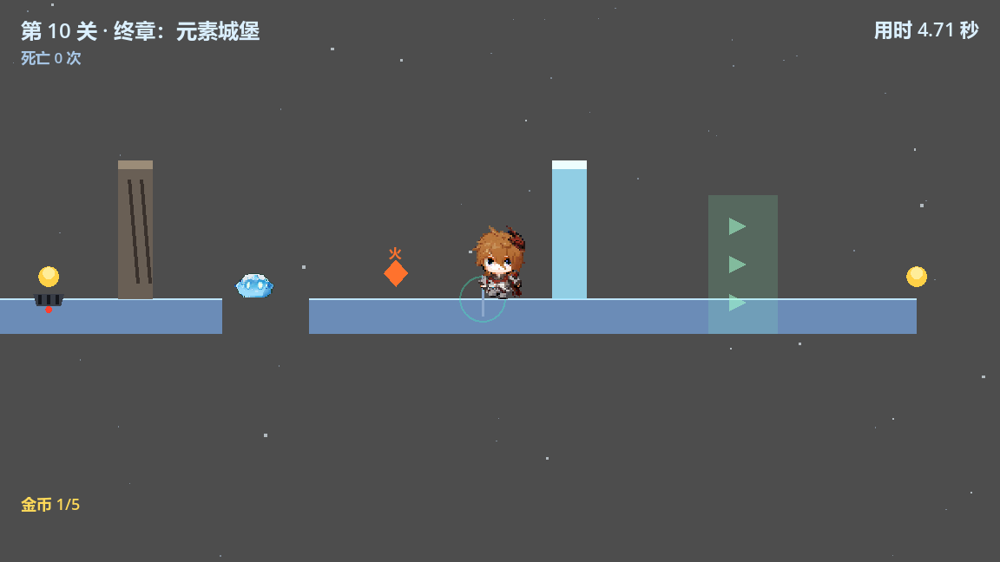
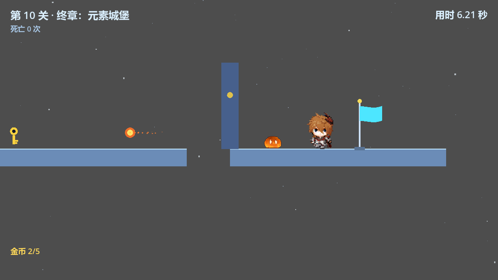
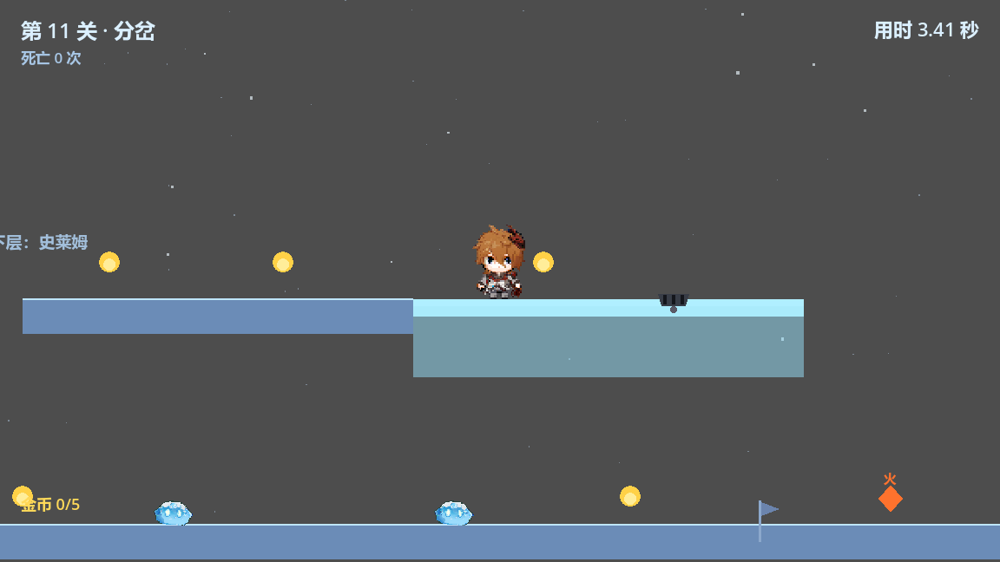
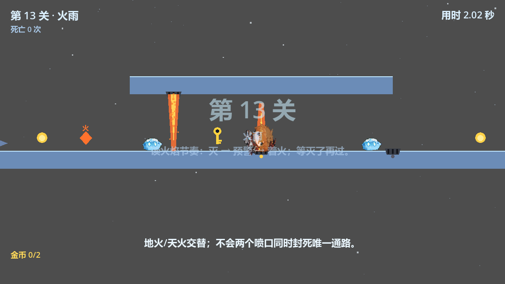

# 冰塔跳跃 · 14 关设计思路（马里奥 + 元素）

> 2026-10-22 晚：主角 1~3 关删除，重新按「马里奥式平台 + 元素解谜」设计 10 关。
> 2026-10-24：1~10 保持不动，新增 11~14 扩展关（分岔 / 风车 / 火雨 / 冰宫）。
> 2026-10-27：修「第 10 关缝隙掉下去不死」（死亡区形状没生效）；金币改成检查点存档；
> 角色 / 史莱姆外观修正（贴图帧错位、最近采样、关掉碰撞形状调试绘制）；10 / 11 / 13 关数值微调。
> 细节和验收见 **第 5 节**。

## 0. 核心

- **马里奥式**：跳坑、金币、史莱姆、移动平台、旗杆式终点。
- **元素**：火 / 水 / 冰 / 风 / 岩石；每关一个主题或两三个元素的组合。
- 操作不变：A/D 移动、空格跳、R 重开；死亡回检查点，整关机关复位
  （**金币例外**：检查点之前吃到的会保留，见 5.2）。

## 1. 十四关总表

| 关 | 名字 | 一句话 | 教什么 | 元素 |
|---|---|---|---|---|
| 1 | 绿色平原 | 跳坑、金币、史莱姆 | 基础手感 | 无 |
| 2 | 水管与平台 | 移动平台 + 钥匙门 | 移动平台 | 无 |
| 3 | 火之花 | 火融冰墙 + 火盆门 | 火 | 火 |
| 4 | 冰之谷 | 冻桥 + 滑冰 + 短火焰 + 冰墙 + 钥匙 | 冰 / 火 | 冰·火 |
| 5 | 风之丘 | 移动平台 + 风区 + 冰墙 + 钥匙 | 风 / 火 | 风·火 |
| 6 | 岩石矿洞 | 石墙 + 石柱 + 钥匙 | 岩石 | 岩石 |
| 7 | 水之洞 | 水灭火 + 冰墙 + 钥匙 | 水 / 火 | 水·火 |
| 8 | 元素回廊 | 冰 / 岩 / 火 / 风 | 四元素 | 四种 |
| 9 | 天空之城 | 风场垂直起飞 + 喷火史莱姆 | 风 / 火 | 风·火 |
| 10 | 终章：元素城堡 | 五元素 + 地火 + 史莱姆 + 喷火 | 综合 | 五种 |
| 11 | 分岔 | Y 型选路：上层冰滑道 3 金币 / 下层史莱姆 2 金币；河流延长 + 1 倍处地火 | 选路 | 冰·火 |
| 12 | 风车 | 风场升降台 + 上层钥匙/金币房 + 火盆门 | 移动平台+风场 | 火 |
| 13 | 火雨 | 环型房间 + 地火/天火交替 + 可选钥匙；天花板抬高 1.3 倍 | 火焰节奏 | 火 |
| 14 | 冰宫 | 冰滑道 + 风场 + 火融冰墙 + 锁门 + 三层 | 综合 | 冰·火·风 |

## 2. 逐关

### 第 1 关 · 绿色平原（马里奥 1-1）

- **想教**：跳坑、金币、史莱姆；没有任何元素，先把操作跑顺。
- **结构**：四段地面，三个 100 像素的坑；5 枚金币；3 只蓝色史莱姆；检查点在中间。
- **为什么**：第一关不塞机制，玩家只需要记住“空格跳、坑会死、金币能捡”。
- **验收**：三条命内到终点；金币至少吃到 3 枚。

### 第 2 关 · 水管与平台

- **想教**：移动平台；钥匙门。
- **结构**：两个 400 像素的大坑，各一块横向移动平台；最后 2300 拿钥匙、2600 开门、2800 终点。
- **为什么**：马里奥的“等平台”节奏；钥匙门第一次出现，告诉玩家“钥匙是必需道具”。
- **验收**：两次都能坐上平台；钥匙门能开。

### 第 3 关 · 火之花

- **想教**：火元素；火融冰墙；火盆开门；地火节奏。
- **结构**：火种 300 → 冰墙 800 → 地火 1200 → 火盆 1800 → 火门 2000 → 终点 2600。
- **为什么**：马里奥“火之花”的对应关；火有两个用途（融墙、点火盆），但都很直观。
- **验收**：能融墙、能闪地火、能开门。

### 第 4 关 · 冰之谷

- **想教**：冰桥、滑冰、短火焰、火融冰墙、钥匙门。
- **结构**：冰种 250 → 冻桥 400~1000（600 宽）→ 短火焰 850（60 高）→ 火种 1200 → 冰墙 1300 → 钥匙 1700 → 钥匙门 2200 → 终点 2600。
- **为什么**：冰面最高速 348，滑到火焰和 100 坑前必须跳；冰与火在同一关各用一次。
- **验收**：能冻桥、能滑、能跳过短火焰和坑、能融墙、能开门。

### 第 5 关 · 风之丘

- **想教**：风区加速跳远；移动平台；火融冰墙。
- **结构**：两个 300 坑用移动平台；中间 130 坑借风区跳；火种 1400 → 冰墙 1600 → 钥匙 2100 → 门 2500 → 终点 2800。
- **为什么**：风不是把人吹起来，而是把最大速度临时提高，跳得更远；和马里奥的“加速跑”感觉接近。
- **验收**：两个平台都能坐；130 坑能借风跳过；火墙钥匙门能过。

### 第 6 关 · 岩石矿洞

- **想教**：岩石砸墙；岩石顶起石柱。
- **结构**：岩石球 300 → 石墙 900 → 石柱 1500 → 钥匙 2000 → 门 2400 → 终点 2800。
- **为什么**：岩石的两种用法一次教完；石柱是“从地里长出来的台阶”。
- **验收**：能砸墙、能升柱、能开门。

### 第 7 关 · 水之洞

- **想教**：水会浇灭火种；带着火跳过水幕。
- **结构**：火种 400 → 水幕 800 → 冰墙 1100 → 钥匙 1600 → 门 2000 → 终点 2800。
- **为什么**：水不是即死，而是“清掉你手里的火”；玩家要跳过去，而不是走进去。
- **验收**：火能保住到冰墙；水幕能跳过；钥匙门能开。

### 第 8 关 · 元素回廊

- **想教**：冰、岩、火、风四种元素在同一关各用一次。
- **结构**：冰种 250 → 冻桥 600 → 岩石 800 → 石墙 1000 → 火种 1200 → 冰墙 1400 → 风区 1600 → 钥匙 1900 → 门 2600 → 终点 3000。
- **为什么**：第 3~7 关的单元素在这里合并；顺序明确，不会同时要求两种元素。
- **验收**：四种元素都能用上；钥匙门能开。

### 第 9 关 · 天空之城（风场垂直起飞）

- **想教**：风场把玩家托到高处；喷火史莱姆。
- **结构**：起点 1500 → 风场 700,1150（300×600，顶面 850）→ 高台 950~1550 顶面 880 → 喷火史莱姆 1150 → 钥匙 1250 → 门 1400 → 终点 1500。
- **为什么**：前面都是横向，这一关改成“向上爬”；也是演示视频里最好看的一段。
- **检查**：这一关是竖向风场，`关卡检查.bat` 的抛物线模型不适用，单独用真人试玩验收。
- **验收**：能站进风场、被托到高台、躲开火球、开门到终点。

### 第 10 关 · 终章：元素城堡

- **想教**：五种元素 + 地火 + 史莱姆 + 喷火史莱姆的综合关。
- **结构**：冰种 250 → 冻桥 600 → 岩石 900 → 石墙 1100 → 火种 1400 → 冰墙 1600 → 风区 1800 → 地火 1000/2200 → 钥匙 2400 → 门 2900 → 喷火史莱姆 3050 → 终点 3200。
- **为什么**：把前面所有机制串一遍；有检查点，死一次不用从头来。
- **验收**：能走完整条链；五种元素至少各用一次；钥匙门能开。
- **2026-10-27 调整**：
  - 倒数第二块平台（2100~2800）上的巡逻史莱姆撤掉 —— 这里是跳向最后一块平台和钥匙门的落点，怪占着容易被撞下去。
  - 喷火史莱姆 3000 → **3050**：离最后一块平台左边缘从 100 提到 150（×1.5），从 2800~2900 的缝隙跳上来时有更宽的落地区。
  - 死亡区：5 块平台铺到 3400，原来死亡区只有 2400 宽（形状没生效），2900 之后掉下去不会死；已修，现在覆盖 -200~3500。

### 第 11 关 · 分岔

- **想教**：第一次选路；上层快而险（冰滑道 + 3 金币），下层稳而慢（史莱姆 + 2 金币）。
- **结构**：起点高台（顶 520）→ 跳过 100 缺口 → 上层平台 500~950 → 河流/冰桥 950~1400 → 落回下层 1300~1800 → 火盆 1700 → 门 1900 → 终点 2250；下层 400~1400 是史莱姆走廊。
- **为什么**：两条路都到汇合点，上层要冰元素冻桥、下层要躲史莱姆，“选哪条”本身就是内容。
- **2026-10-27 调整**：
  - 河流（水池/冰桥）300 → **450**（950~1400，×1.5），左端不动，右端接到下层 1300~1800 平台的正上方。
  - 1 倍处（旧右端 x=1250）加一个**地火**：挂在冰面 y=520 上，朝上喷、默认长 110；间歇节奏（灭 1.5s → 预警 0.4s → 着火 1s），要趁灭滑过去 —— 跳不过去（跳跃高度 92 < 110）。
  - 净空：冰桥底 540 → 下层地面 780 = 240，不撞头。
- **验收**：两条路都能到汇合点；冰桥能冻；地火能掐时间过。

### 第 12 关 · 风车

- **想教**：风场竖井 + 上下升降台；上层可选钥匙 + 金币房。
- **结构**：下层 0~1200（地火 800、史莱姆 600）→ 竖井升降台（1200，行程 ±90）→ 风场 → 上层 1300~1900（钥匙 1400、钥匙门 1600、金币房 1800）→ 下层 1900~2400（火盆 2200、门 2300）→ 终点 2400。
- **为什么**：把“等平台”和“风场托举”合在一起；钥匙是可选，走支路多拿金币。
- **验收**：升降台能坐；风场能托上上层；支路钥匙能拿；火盆门能开。

### 第 13 关 · 火雨

- **想教**：地火 / 天火交替的节奏；低天花板下的走位。
- **结构**：地面 100~1700 + 1800~2200 → 天花板 700~1300 → 地火 1000 / 1300（y=780）→ 天火 800（挂天花板底面）→ 史莱姆 700 / 1200 → 钥匙 900 → 钥匙门 1600 → 火盆 1700 → 门 1900 → 终点 2100。
- **为什么**：火焰不是“躲一次”，而是“等一轮”；三个喷口相位错开，保证不会同时封死唯一通路。
- **2026-10-27 调整**：
  - 上层平台（天花板）中心 660 → **630**：底面 680 → 650，离地净空 100 → **130**（×1.3）。
  - 天火 x=800 跟着从 680 → 650，长度 110 → 130，保持烧到地面 780，判定范围和原来一致（不会在脚下留缝）。
  - 可跳高度从 58 提到 88；工具仍报 WARN（净空 130 < 189），属于这一关“低天花板”的既定设计。
- **验收**：三处火焰都能等到“灭”的窗口；钥匙门能开；终点可达。

### 第 14 关 · 冰宫

- **想教**：三层结构 + 冰滑道 + 风场 + 火融冰墙 + 锁门。
- **结构**：一层 200~900（冰滑道 500~900）→ 风场 1000 → 二层 1200~1900（冰墙 1500、钥匙 1600、锁门 1700）→ 风场 1900 → 三层 2000~2500 → 终点 2450。
- **为什么**：收尾关把冰 / 风 / 火串成一条竖向链路，两个检查点分别对应一层和二层。
- **检查**：竖向风场，`关卡检查.bat` 不模拟，单独真人试玩。
- **验收**：滑道能冻、风场能上二层 / 三层、冰墙能融、锁门能开。

## 3. 检查

- `自检.bat`：14 关脚本 + 场景全部加载。
- `关卡检查.bat`：检查 1~8、10~13 共 12 关的跳跃几何、头顶净空，以及**掉落死亡区是否盖住整关**（2026-10-27 新增，见 5.1）；第 9 关「天空之城」和第 14 关「冰宫」是竖向风场，工具不模拟，单独真人试玩。
- 12 关出生点到终点都可达，死亡区覆盖全部通过。
- 金币「检查点存档」用临时回归脚本验过（第 11 关：吃 2 枚 → 检查点 → 再吃 1 枚 → 死 → 复活 2 枚），验证后已删除。

## 4. 3 天 / 10 天

- **3 天节点（10/23）**：1~5 关 + 网页 / exe；先保证能玩。
- **10 天节点（10/30）**：14 关 + 仓库 + 演示视频 + 说明文档 + AI 使用声明。
- 第 9/14 关（风场）和第 12 关（升降台）是 10 天版加分项；试玩不稳可先砍到 1~11 关。

## 5. 2026-10-27 本轮修改记录

### 5.1 掉落死亡区：第 10 关“缝隙掉下去不死”（P0）

- **现象**：第 10 关最后两块平台（2100~2800 / 2900~3400）中间掉下去，玩家一直往下掉，不会死；相机停在边界上，看起来像卡死。
- **根因**：`scenes/world/death_zone.tscn` 的 `CollisionShape2D` 本来没有 shape，形状是 `scripts/death_zone.gd` 的 `_ready()` 按 `zone_size` 现建的。而 `level_base._add_death_zone()` 以前写的是“先 `add_child()`、再 `setup(size)`”——`add_child()` 会**同步**触发 `_ready()`，那一刻读到的还是默认值 2400，形状就永远定在 **2400×200、居中于关卡中点**。第 10 关宽 3400，最右边 550 像素（含整块最后平台）都是无底洞。14 关里 12 关都缺一截。
- **修法**：
  - `death_zone.gd`：`setup()` 在已进树时也立刻重建形状；`_ready()` 统一走 `_apply_size()`；场景里漏了 `CollisionShape2D` 会自己补一个，避免变成“没形状的摆设”。
  - `level_base._add_death_zone()`：改成**先写 `zone_size`、先摆位置，再 `add_child()`**，从源头上不依赖调用顺序。
  - `tools/verify_levels.gd` 新增 `_check_death_zone()`：死亡区必须盖住本关所有落脚面的水平范围，否则直接 FAIL（`关卡检查.bat` 会报出来）。
- **验证**：14 关死亡区实测覆盖均 ≥ 落脚面范围；真跑第 10 关把玩家丢进 2800~2900 缝隙，约 80 帧（1.3 秒）后判死并回检查点。

### 5.2 金币改成「检查点存档」

- **规则**（解决“检查点前吃的金币，死一次就白吃”）：

| 情况 | 复活后 |
|---|---|
| 检查点**之前**吃掉的 | 数量保留，地图上保持消失 |
| 检查点**之后**吃掉的 | 数量退回，金币重新出现在地图上 |
| 还没碰过检查点就死 | 归 0，全部重新出现（等于没有存档） |
| 之后又碰到新检查点 | 快照更新为那一刻的进度 |

- **实现**：
  - `scripts/collectibles/coin.gd`：加 `coin_id`，以及 `is_taken()` / `set_taken_state()`（静默设为已吃/未吃，不播音效、不加分）。
  - `scripts/level_base.gd`：`_on_checkpoint_reached()` 调 `_snapshot_coins()` 记下已吃金币编号；复活时 `_reset_hazards()` 先把金币全放回，再 `_restore_coins_after_respawn()` 把存档里那几枚重新藏掉，同时把 `GameState.coins` 恢复成存档数量（HUD 每帧读 `GameState.coins`，会自动对上）。
- **踩到的坑**：第一版复活后金币莫名 +1。原因是金币恢复监测的那一帧，物理服务器里玩家还停在**死亡位置**，死亡点那枚金币被立刻又“捡”了一次。现在 `_respawn()` 先把玩家放回复活点、**等 2 个物理帧**同步完 transform 和碰撞形状，再复位机关。
- **范围**：只改了金币；钥匙、元素球仍然随复活重置。

### 5.3 角色 / 怪物外观

- **“蓝色小框”不是贴图问题**，是编辑器的「可见碰撞形状」调试绘制（`.godot/editor/project_metadata.cfg` 里 `run_debug_collisions=true`）：玩家身上那层半透明蓝绿胶囊、史莱姆身上的大圆圈、金币外的圆环，都是 `CapsuleShape2D` / `CircleShape2D` 的调试图。
  - `level_base._ready()` 每次进关卡执行 `get_tree().debug_collisions_hint = false`；项目元数据里的开关也改成了 `false`。想临时看碰撞盒，运行中在编辑器 Debug 菜单重新勾上即可。
- **怪物贴图帧错位**：`scripts/enemies/6元素史莱姆.png` 是 12×8 个 48×48 格，但 `walker.tscn` / `fire_shooter.tscn` 原来按 36 像素切帧（144/180/216/252、0/36/72/108），史莱姆被切掉一块、还串进隔壁史莱姆的颜色。现在按 48×48 三帧重建：巡逻怪用冰史莱姆（x=144/192/240，y=192），喷火怪用火史莱姆（x=0/48/96，y=0）。
- **像素画模糊**：`project.godot` 增加 `textures/canvas_textures/default_texture_filter=0`（最近采样），和参考项目「新建游戏项目」一致。玩家 idle/run 的帧本来就和参考项目相同（48×48，x=0/48/96，y=0/96），只差这个采样设置。
- **截图**（拍摄时故意打开了碰撞形状开关，画面里仍然没有蓝框）：
  
  

### 5.4 关卡数值调整

- **第 10 关**
  - 倒数第二块平台（2100~2800）撤掉巡逻史莱姆：它是跳向最后一块平台和钥匙门的落点，怪占着容易被撞下去。
  - 喷火史莱姆 3000 → **3050**：离最后一块平台左边缘 100 → 150（×1.5），从缝隙跳上来时有更宽的落地区。
- **第 11 关**
  - 河流（水池 / 冰桥）300 → **450**（950~1400，×1.5），左端不动。
  - 1 倍处（旧右端 x=1250）加地火：`y=520` 挂在冰面上，间歇（灭 1.5s / 预警 0.4s / 着火 1s），靠读节奏过；跳跃高度 92 < 火焰 110，不能靠跳。
  - 净空校验：冰桥底 540 → 下层地面 780 = 240，不撞头。
  - 
- **第 13 关**
  - 上层平台（天花板）中心 660 → **630**：底面 680 → 650，离地净空 100 → **130**（×1.3）。
  - 天火 x=800 跟着从 680 → 650，长度 110 → 130，保持烧到地面 780，判定范围不变（不会在脚下留一条看似能钻的缝）。
  - 可跳高度从 58 提到 88；工具仍报 WARN（净空 130 < 189），属于这一关“低天花板”的既定设计。
  - 

### 5.5 检查结果

- `关卡检查.bat`：14 关全部可达；新增的死亡区覆盖检查全过；第 13 关保留 1 条低天花板 WARN（预期内）。
- `自检.bat`：脚本 / 场景 / 输入映射 / 单例 / 主场景全部正常。
- 冒烟测试：第 1~3 关的失败位置与本轮修改前完全一致（旧机器人策略问题，不是这几处改动引起的）。
