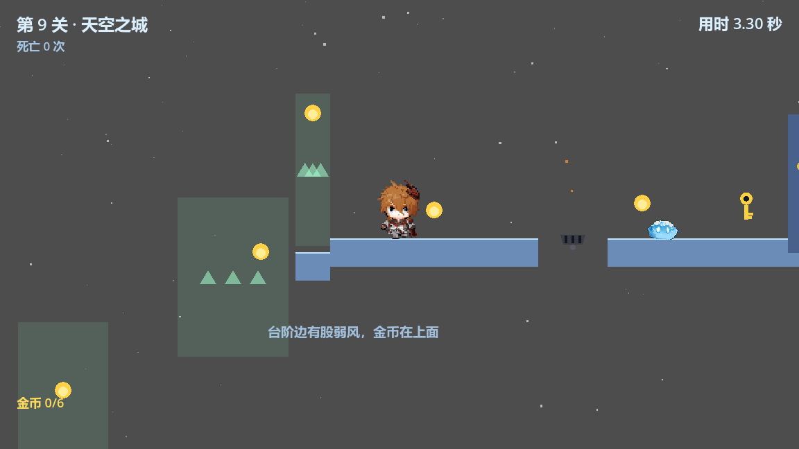
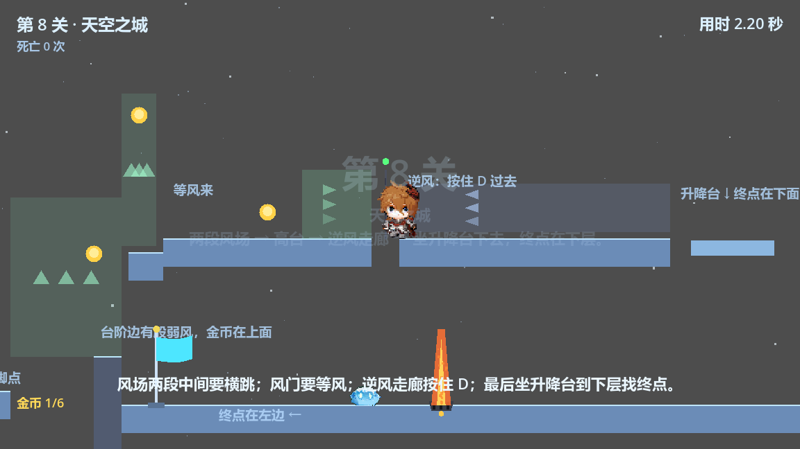
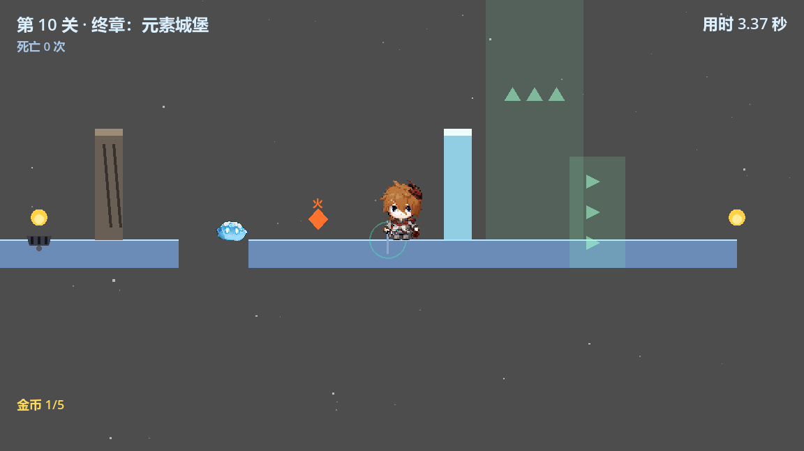

# 冰塔跳跃 · 5 关设计思路（最新版）

> 2026-10-30 按当前代码的实际布局同步。本文只描述这一版“是什么、为什么”，
> 不再保留历史改号过程；旧文档里的 11 关 / 14 关编号与已删除的关卡
> 已经不对应现在的版本。
> 关卡顺序与数值以 `scripts/levels/level_1.gd` ~ `level_5.gd` 为准。
> **2026-10-30 晚：原第 5~10 关（风之丘 / 岩石矿洞 / 水之洞 / 元素回廊 / 风车 / 冰宫）
> 整组挪到同级的新项目 `..\废弃关卡`（只存档不整理），仓库里对应文件已删；
> 原第 11 关「终章：元素城堡」就是现在的第 5 关。**

## 0. 一页看完

- 5 关，2D 平台跳跃 + 元素解谜；每关一个主题，最后一关综合。
- 顺序：绿色平原 → 火雨 → 分岔 → 天空之城 → 终章：元素城堡。
- 难度曲线：1 基础 → 2 节奏/火 → 3 选路 → 4 风场回字 → 5 综合（冰岩火风）。
- 金币合计 25 枚（5 / 3 / 4 / 6 / 7）；第 4 关没有检查点，第 5 关有两个（1150 / 1790）。
- 游戏里没有“受伤”和“攻击”：掉下去、碰火、横向撞怪都是即死；唯一的主动交互是“从上方踩史莱姆”。

## 1. 核心规则

### 1.1 操作

- A / D 左右移动，空格跳（短按小跳、长按大跳），R 重开，ESC 暂停。
- 没有攻击键：敌人靠跳、躲、踩（压扁）处理，不靠打。

### 1.2 死亡与复活

- 掉进死亡区、碰到火焰/火球、横向撞到史莱姆，立即死亡，没有血量。
- 死亡后约 0.55 秒回到最近检查点；整关机关复位：
  元素球/钥匙/金币回到地图、冰桥变回水、冰墙/石墙恢复、石柱缩回、
  火盆/按钮/门关闭、移动平台回起点、火焰/敌人复位、空中的火球清掉。
- 玩家手里的元素和钥匙清空；检查点本身保留。
- 金币是例外：检查点之前吃掉的保留，检查点之后吃掉的回滚（见 1.4）。

### 1.3 史莱姆（压扁弹跳）

- 巡逻史莱姆：在出生点 ±patrol 内来回走，到边界掉头，速度 55~60。
- 喷火史莱姆：站桩，每 2.2 秒朝固定方向喷一颗火球；喷前 0.35 秒身体变红预警。
- 从上方踩中：史莱姆压扁成原高度的 22% 薄片，玩家以 0.7 倍跳力弹起
  （-480 × 0.7 = -336，弹高约 45 像素）。
- 压扁持续 0.8 秒；期间史莱姆不巡逻/不喷火、碰撞关闭；玩家离开 20 像素后才弹回原状。
- 横向撞到：玩家死；从下方顶到按横向算；史莱姆不会被踩死。

### 1.4 金币与检查点

| 情况 | 复活后 |
|---|---|
| 检查点之前吃掉的金币 | 数量保留，地图上保持消失 |
| 检查点之后吃掉的金币 | 数量退回，金币重新出现 |
| 还没碰过检查点就死 | 归 0，全部重新出现 |
| 之后又碰到新检查点 | 快照更新为那一刻的进度 |

- 金币不是通关条件，只影响结算和关卡选择的 ★（拿满本关全部金币）。
- 每关金币数不同：第 1 关 5、第 2 关 3、第 3 关 4、第 4 关 6、第 5 关 7。

### 1.5 终点与存档

- 碰到终点旗 → 结算（时间 / 死亡 / 金币）→ 解锁下一关。
- 共 5 关，存档版本 5；旧存档（v1 / v2 / v3 / v4）读入时按新关号自动迁移。

## 2. 物理参数与设计红线

| 参数 | 值 | 备注 |
|---|---|---|
| 水平最大速度 | 240 | 冰面 348 |
| 地面加速度 | 15 倍 | 约 1/15 秒到全速 |
| 空中加速度 | 0.5 倍 | 空中转向带一点惯性 |
| 起跳速度 | -480 | 摸高 ≈ 92 像素 |
| 重力 | 1250 | 下落时 ×1.35 |
| 松键截断 | 0.45 | 短按小跳 |
| 最大下落速度 | 900 | 防止穿过薄平台 |
| 土狼时间 | 0.10 秒 | 刚离开平台还能跳 |
| 跳跃缓冲 | 0.12 秒 | 落地前按跳也会生效 |
| 碰撞盒 | 胶囊 13 × 42 | 视觉放大 1.8 倍，判定不变 |

**能力表**（理论值，含 0.85 安全系数与 12 像素助跑）：

| 需要上升 | 0 | 10 | 20 | 30 | 40 | 50 | 60 | 70 | 80 | 90 |
|---|---|---|---|---|---|---|---|---|---|---|
| 能跨的最远空隙 | 146 | 142 | 138 | 134 | 129 | 124 | 118 | 111 | 103 | 89 |

**设计红线**（摆关时按这个留余量，不要按理论上限）：

- 平跳 ≤ 100；升 30 ≤ 90；升 60 ≤ 75。
- 两层平台净空 ≥ 189：碰撞盒 42 + 摸高 92 + 1.8 倍视觉高 86 ≈ 178，再留约 10 余量。
  第 2 关浮台压第 4 级只有 100，是刻意的特例（第 4 级不能起跳，要从右侧绕）。
- 移动平台：宽 ≥ 120；水平行程 180~240、速度 55~80；垂直行程 180~220、速度 55~150。
- 坑宽：100 是普通跳；120 带金币；130 需要风区；300 需要移动平台；400 必须坐平台。
- 门宽 40，高 160~200；门不能当“能站人的平面”登记。

## 3. 机关速查

| 机关 | 规则 | 出现关卡 |
|---|---|---|
| 金币 | 碰触即得，不挡路 | 全部 |
| 检查点 | 记录复活点 + 金币快照 | 1、2、3、5（第 5 关两个，第 4 关没有） |
| 钥匙 / 钥匙门 | 拾取后带钥匙走近自动开；死亡后门重新关上 | 1、3、5 |
| 元素球 | 拾取火/冰/岩，一次一个，死亡清空 | 2（火）、3（冰）、5（冰/岩/火） |
| 冰墙 | 火融化，40~50 × 160，跳不过去 | 2、5 |
| 石墙 | 岩石砸开（机制在，当前没有关卡调用） | 无 |
| 石柱 | 岩石顶起 +60，当台阶（机制在，当前没有关卡调用） | 无 |
| 石柱桥 | 站上特殊岩石地面，一次升起一排柱子，柱顶 +60，用来跨断层 | 5 |
| 悬浮台阶 | 风场顶上的小平台，只当落脚点；故意不登记落脚面（验证器不建模风场） | 5 |
| 冻池 | 冰种冻结成冰桥，冰面最高速 348。第 5 关是普通冻池（填 300 宽的坑）；第 3 关是“下沉水池”：水面比桥面低 80、水深 70，没冻住掉进去会穿到下层 | 3、5 |
| 冰封水源 | 纯装饰：冻住的水源，不挡路也不淹人（冰墙在它右边） | 5 |
| 水幕 | 浇灭手中的火（机制在，当前没有关卡调用） | 无 |
| 风区 | 进入给水平加速，用来跳远（机制在，当前没有关卡调用：第 5 关的水平风场会把人吹进地火，已删） | 无 |
| 风场 | 持续上托 260；弱风 104 | 4（两段 + 弱风）、5（蒸汽） |
| 逆风 | 目标速度 -160，按住 D 顶过去 | 4 |
| 风门 | 6 秒周期吹 3 秒，只在吹的时候开门 | 4 |
| 地火 | 周期 2.9 秒（灭 1.5 / 预警 0.4 / 着火 1.0） | 2、3、4、5 |
| 天火 | 固定周期（灭 1.5 / 预警 0.9 / 烧 1.5，周期 3.9 秒）；压力板触发模式仍保留但当前关未用 | 2 |
| 压力板 | 踩下 / 松开发信号（当前无关卡使用） | 无 |
| 移动平台 | 水平或垂直往返，站上去会被带走（第 4 关是竖井升降台） | 1、4 |
| 巡逻史莱姆 | ±patrol 来回；踩扁 + 弹起；横向即死 | 1、3、4、5 |
| 水史莱姆 | 浅蓝巡逻怪；只有冰霜地带还有效时踩进去才会被冻住 2.5 秒，冻结期间挡路 | 3 |
| 冰霜地带 | 玩家踩上去后脚下结冰 2 秒（用来冻水史莱姆） | 3 |
| 喷火史莱姆 | 站桩 2.2 秒喷火球，0.35 秒前变红；踩扁规则同上 | 5 |
| 死亡区 | 掉下去即死，必须盖住整关落脚范围 | 全部 |

## 4. 5 关总表

| 关 | 名字 | 一句话 | 教什么 | 元素 | 金币 | 怪 | 检查点 |
|---|---|---|---|---|---|---|---|
| 1 | 绿色平原 | 跳坑、躲史莱姆、等移动平台、拿钥匙 | 基础操作 | 无 | 5 | 1 巡逻 | 1 |
| 2 | 火雨 | 下行到最低点，阶梯上行（第 1、2 级相接，接缝横向火），浮台火种融冰墙 | 地火 / 天火 / 横向火 | 火 | 3 | 0 | 1 |
| 3 | 分岔 | 冻池成桥走上层冰桥 / 掉下去走下层史莱姆 | 选路 | 冰·火 | 4 | 2 水史莱姆 | 1 |
| 4 | 天空之城 | 两段风场横跳 → 弱风 → 风门 → 逆风 → 升降台 | 风场回字 | 风 | 6 | 1 巡逻 | 0 |
| 5 | 终章：元素城堡 | 冰岩火风 + 地火 + 石柱桥跨 300 断层 + 熔岩回廊 + 两种史莱姆 | 综合 | 四种 | 7 | 1 巡逻 + 1 喷火 | 2 |

> **怎么调整关卡顺序**：只改 `scripts/autoload/game_state.gd` 里的
> `LEVEL_ORDER`（第 i 个元素 = 第 i 关加载哪个关卡文件），例如想把「天空之城」放第 3 关、
> 「分岔」放第 4 关，就把数组前四项写成 `[1, 2, 4, 3]`。
> 关卡文件名、脚本里的 `level_number`、存档都不用动：存档按关卡编号（身份）记，
> 界面上的「第几关」和 HUD 关号按位置自动换算。

## 5. 逐关
### 第 1 关 · 绿色平原

- **想教**：基础操作闭环——跳坑、吃金币、踩/躲史莱姆、等移动平台、拿钥匙开门。
- **结构**：
  - A 出生：-100~400（顶 780）。
  - B 两坑：520~900、1020~1700；坑 400~520 与 900~1020 各 120，坑上方金币 460 / 960（y 710）。
  - C 史莱姆：x=1280，巡逻 ±60（1160~1340），金币 1250；检查点 1560。
  - D 大坑：1700~2100（400），移动平台中心 1900、宽 130、行程 ±120、速度 70。
  - E 出口：2100~3200；钥匙 2300、门 2600、终点 2800、门后金币 2700。
- **数据**：金币 5；怪 1；检查点 1；死亡区 -200~3300。
- **为什么**：合并后没有独立的“平台教学关”，一关内必须走完“跑 → 跳 → 等 → 拿钥匙”；
  平台速度只有 70，第一次见移动平台不要求精准跳。
- **验收**：5 枚金币都能拿到；检查点后死亡不用重跑前 1560；建议 3 次死亡内通关。

### 第 2 关 · 火雨

- **想教**：地火读节奏、天火固定周期、横向火等窗口、浮台火种融冰墙。
- **结构**：
  - 入口 100~450（顶 780）；地火 450：灭 2.6 → 预警 0.4 → 着火 1.0（周期 4.0，相位 0.5，开局 1 秒后第一次着火）。
  - 走廊 450~800：地面 780；低天花板平台已删除（2026-10-30），现在净空 260，可以跳；压力板与起点天火已删。
  - 下行：800~980（顶 900）→ 960~1100（顶 1010）。
  - 最低点 900~1300（顶 1200）：天火 1040（悬空，长 130，向下；灭 1.5 → 预警 0.9 → 烧 1.5，周期 3.9）、检查点 1240。
  - 上行 5 级：1300~1490（1130，第 1、2 级接成一条）、1490~1640（1060）、1680~1830（990）、
    1870~2020（920）、2060~2210（850）；第 1、2 级接缝处有横向火，第 4 级左缘地火 1905。
  - 横向火（x≈1490）：喷口在第 2 级左缘、朝左水平喷，长 130；灭 1.5 → 预警 0.9 → 烧 1.5（周期 3.9）；
    覆盖第 1 级右半段，站到第 1 级左侧等火灭再上。
  - 浮台 x1840~1990（脚本中心 1915,800；宽 150、厚 40，顶 780，与高处平台等高）：火种 1915,770；从第 5 级 2060~2210 向左跳上去。
  - 高处 2250~2450（顶 780）：冰墙 2350、终点 2420。
- **数据**：金币 3；怪 0（史莱姆已换成天火）；检查点 1；死亡区 -200~2550。
- **为什么**：倒 V 把检查点放在最低点，死亡不用重跑前半段；
  第 1、2 级接成一条，去掉接缝处的小跳，改成“等横向火窗口”的时机题；
  火种放在阶梯上方的浮台上，让玩家在最后一段从第 5 级向左跳一次、再融墙；
  地火教“等”，天火教“看到 0.9 秒预警后让开 1.5 秒燃烧窗口”，横向火教“等喷口灭了再过”；
  地火 450 高 110，跳不过它的顶端，仍然只能等灭；低顶删掉后走廊可以跳，节奏题只剩火。
- **注意**：工具会报 3 处净空不足 WARN（150 / 70 / 100，低于 189 红线）；
  其中 100（浮台压第 4 级）是本关刻意设计，不是 bug。
  浮台 1840~1990（中心 1915,800）在第 4 级（1870~2020）上方（净空 100）：第 4 级到第 5 级要从浮台右侧（x>1990）起跳，
  否则会撞浮台；火种则从第 5 级向左跳上浮台拿。
- **验收**：火种能拿到；冰墙能融；两处地火都能等到窗口；天火能躲（或等它烧完）；横向火能等到熄灭再过；浮台跳得上去。

### 第 3 关 · 分岔

- **想教**：第一次选路（真正的分岔在过桥之后：跳下去补下层，还是继续冰桥）；
  以及下层的第一条"走位题"——两只水史莱姆，要把它们引到冰霜地带里冻住再越过。
- **结构**（2026-10-29 现状，坐标以 `scripts/levels/level_3.gd` 为准）：
  - 起点平台 -100~350（顶 520）；冰种 -80（平台左缘往右 20）。
  - 冻结水池 350~590（宽 240）：水面 600（比桥面低 80），水底 670（水体深 70），坑高 150；
    冻住后冰桥顶面 520，与两侧齐平；**没冻住掉进去会穿到下层**（下层入口之一）。
  - 上层平台 590~950（顶 520，宽 360）；金币 700 / 880。
  - 冰桥 950~1400（顶 520）：常驻冰面材质（打滑，最高速 348），x=1250 地火（相位 0）。
  - 下层平台 400~1400（顶 780）：
    - **冰霜地带两处**：580~720 与 930~1070（各宽 140，中心 650 / 1000）；玩家踩进区域后，
      脚下地面变成浅蓝冰面 2 秒（`active_time` 默认 2，触发冷却 1 秒）；
    - **水史莱姆两只**（浅蓝贴图，与普通史莱姆同一套图，只靠冰晶形态区分）：570~730
      （中心 650，±80，速度 55）与 1020~1200（中心 1110，±90，速度 60）；
      区域内有效时走进冰面会被冻 2.5 秒（变冰晶、实心、不攻击），区域结束后恢复巡逻；
    - 金币 500 / 1200；钥匙 880（两只水史莱姆正中间）；检查点 1350（竖长触发区 300，桥面高度掉下来也能激活）。
  - 汇合 A 1300~1800、B 1900~2300（顶 780，中间 100 缺口，钥匙门 1900 卡在缺口上）；
    火种 1500、火盆 1700、终点 2250；死亡区 y 1050（-200~2500）。
- **为什么**：上层快而险（冰面滑 + 地火），下层稳而慢（史莱姆）；
  上层 2 枚金币是主线奖励，下层 2 枚金币 + 踩怪是过桥后的可选支线；
  上层 520 / 下层 780，净空 220，下层起跳不撞头。
  水池 240 宽大于满速横跳 171，不用冰过不去，冰种是必经道具。
  冰霜地带只维持 2 秒、冷却 1 秒：跑得过去但要卡时间；水史莱姆只有在"区域还有效"时
  进入才会被冻，所以是"先踩亮冰面、再把它引进来"的一次性解法，而不是全屏冻结。
- **2026-10-29 的三笔改动**：
  - 结构（按设计表重排）：水池从“冰桥占位”改成真正的下沉水池（水面低于桥面），
    冻住后冰桥升到桥面高度；950~1400 从“冻池变成的桥”改成常驻冰面平台
    （`scripts/world/platform.gd` 新增 `slippery` + `is_slippery()`，`level_base.gd` 新增 `_add_ice_platform`）；
    水池 150→240 宽，上层平台左端 500→590；冰种 250→-80；金币挪到 700 / 880 与 500 / 1200；
    提示牌文字已删除（说明文字统一清空）。
  - 水池垂直尺寸：先按表做成 下沉 100 / 深 90（水面 620、水底 710、坑高 190），
    试玩后调成 下沉 80 / 深 70（水面 600、水底 670、坑高 150）。
    `water_depth` 已做成参数（`_add_freeze_pool` 第 5 个参数），下限 20；
    “下沉量 + 深度”别超过 210，否则水底会压到下层走廊玩家头顶（780 − 42 = 738）。
  - 下层新机制（按第二版设计表）：新增 `frost_zone.gd`（冰霜地带）与 `water_slime.gd`
    （水史莱姆，继承 `walker.gd`），核心文件还有 `scenes/world/frost_zone.tscn`、
    `scenes/enemies/water_slime.tscn`、`scenes/enemies/slime_plain.tscn`；
    `checkpoint.gd` 加 `reach` 让检查点在桥面高度也能触发；`freeze_pool.gd` 加 `trigger_reach`
    让"跳起来碰到水面"也能冻住。淡绿贴图的 `slime_plain.tscn` 已备好但当前没有关卡使用。
    冰种仍是唯一的冰来源，所以 950~1400 那道水面不再需要冻（否则一个冰种要冻两处，资源死结）。
- **注意**：设计表把汇合 A/B 和终点写成“顶 520”，但下层 780 起跳只有 92，跳不上去；
  表里“上层进入后可落下至共同区域”说明共同区域就在下面那层，所以 A/B/终点保持 780。
- **决定（2026-10-29 两版合并）**：上层保留旧版数值（起点 -100~350、冰种 -80、上层 590~950、
  金币 700 / 880），第二版设计表里“上层 500~850 + 850~950 缺口 + 冰种 250 + 金币 600 / 800”
  按用户要求（“上层保留原来设计”）没有采用；下层按第二版表新增冰霜地带与水史莱姆；
  汇合 A/B 与终点保留下层 780。
  下层入口有两个：没冻住时掉进水池会穿到下层（左端），或从冰桥右端 1400 落到汇合 A 再往左。
- **验收**：冻池后上层主线能到汇合点；掉进水池能安全落到下层；过桥后跳下走下层也能到汇合点；
  水池能冻、能融；地火能掐时间过；下层能跳过水史莱姆；
  冰霜地带踩上去 2 秒后消失、水史莱姆在区域内被冻 2.5 秒且冻结期间挡路、解冻后继续巡逻；
  检查点在桥面高度掉下来也能亮。

### 第 4 关 · 天空之城

- **想教**：两段风场 + 横跳、弱风口、周期风门、逆风走廊、升降台、回字路线。
- **结构**：
  - 起点平台 -100~940（顶 1500）；隔板 x 900~940、y 1050~1500，把终点一侧隔开。
  - 风场① 550~680（y 1000~1450，升力 260）→ 100 缺口 → 风场② 780~940（y 820~1050）；
    缺口下方 680~780（顶 1100）的悬台接住掉下来的人。
  - 高台 1000~1300（顶 880）；左边缘内缩 50（950~1000 顶 900 台阶）；
    台阶上弱风 940~990（y 670~890，升力 104）+ 金币 965,700。
  - 高台右端风门 1320（门 1300~1340，风带 1200~1300；6 秒周期吹 3 秒，只在吹时开门）。
  - 回字上层 1340~1730（顶 880）；逆风 1360~1730（-160），按住 D 顶过去。
  - 升降台 1760~1880（垂直 ±110、速度 150、宽 120）：上层 879 ↔ 下层 1099。
  - 下层 940~1980（顶 1120）：地火 1400、史莱姆 1250、终点 990,1120（向左）。
- **数据**：金币 6；怪 1；检查点 0；死亡区 -200~2100。
- **为什么**：风场从“电梯”变成“要横跳的地形”；弱风是给贴边走的人的奖励
  （金币 + “原来边缘也能用”的发现）；风门教“等风”；逆风教“按住 D 顶”；
  隔板让终点必须绕一圈，把回字形路线走完。
- **注意**：第 4 关是唯一没有检查点的关；从起点掉下去要重跑整段。
  这是当前设计，长关 + 无检查点的风险需要真人试玩确认。
- **验收**：真人试玩（工具不模拟竖向风场）；重点：第一段 → 横跳 100 → 第二段、
  弱风口、风门时机、逆风、升降台。

### （第 5~10 关已移出本仓库）

- 原第 5 关 风之丘、第 6 关 岩石矿洞、第 7 关 水之洞、第 8 关 元素回廊、
  第 9 关 风车、第 10 关 冰宫，2026-10-30 整组挪到同级的新项目 `..\废弃关卡`
  （只存档、不整理）。因此现在没有“岩石砸墙 / 顶单根石柱 / 水幕”的关卡：
  这些机制仍留在 `level_base.gd` 里备用，只是没有关卡调用。

### 第 5 关 · 终章：元素城堡

- **想教**：冰 / 岩 / 火 / 风 + 地火 + 两种史莱姆的综合；岩石的第三种用法——**石柱桥**。
- **结构**：-100~500 → 600~1200 → 1200~1290（特殊岩石地面）→ **断层 1290~1590（宽 300）** →
  1590~2000 → **第三阶段·风场与钥匙** → **熔岩回廊** → 2900~3400；
  冰种 250 + 冻池 600（450~750，冰桥填 500~600 坑）；
  岩石 900 + 地火 1000（相位 0）；
  石柱桥（柱心 1335 / 1435 / 1535，柱宽 70，柱顶 720，比地面高 60）；
  **第二幕·元素熔炉**（表里 1300~2000 的整串坐标右移 290，接在断层右缘 1590 上）：
  史莱姆 1620（走位）→ 火种 1690 → 检查点 1790 → 冰封水源 1800~1860 + 冰墙 1870~1920（火融）→
  蒸汽风场 1930~2096（y 360~780，跨在 2000~2100 的断口上）→ 悬浮台阶 2100~2170（顶面 415）+ 钥匙 2110,378 →
  **熔岩回廊**：入口 2100~2250（顶面 780）→ 下沉平台 2250~2480（顶面 840）→
  60 宽缺口 2480~2540 → 上层 2540~2800（顶面 780）；
  地火 2200（相位 0.5，卡在入口）；检查点 1150 / 1790；钥匙门 2900；喷火史莱姆 3050（朝左）；
  金币 7（500 / 1000 / 1445 断层上空 / 2000 蒸汽通道里 / 2350 下层 / 2650 上层 / 3100）；
  终点 3200；死亡区 -200~3500。
- **断层的玩法**（按参考图，5 步）：① 在 900 拿到岩石，一路带到断层口 → ② 看见前方 300 宽的断层 →
  ③ 断层口有一块深色特殊岩石地面，上面有呼吸的菱形标记 → ④ 带着岩石站上去，
  三根柱子从坑底依次升起（错峰 0.12 秒）→ ⑤ 踩三块柱顶跳过去。
  平跳上限只有 146，300 的断层不可能硬跳；第一根柱子到对岸还有 220，也跳不到，
  所以这里**必须**用石柱，不是可选机关。
- **第二幕的玩法**（按参考表右移 290）：① 过桥落地先躲巡逻史莱姆 → ② 火种 1690 拿火 →
  ③ 检查点 1790 → ④ 在冰封水源前用火融开冰墙（1870~1920）→ ⑤ 跳进 1930~2096 的蒸汽气流。
  站着不会被托起来（只有离地才吃上升速度），所以这一步本身就要按一下跳；
  升到顶再往右挪，落到 2100~2170、顶面 415 的悬浮台阶上，拿到 2110,378 的钥匙。
  一路按着右键也能活着被气流托过 2000~2100 的断口、落到对岸，但拿不到钥匙——
  这就是"不要白给"的那一下空中定位。
- **熔岩回廊的玩法**：① 落在 2100~2250 的入口平台 → ② 等 2200 的地火（相位 0.5）灭了再走 →
  ③ 掉到 2250~2480、顶面 840 的下沉平台 → ④ 在 2480 的右缘按满跳，越过 60 宽缺口回到
  2540~2800、顶面 780 的上层（按一下就松手会把跳高砍成 45%，跳不回去）→ ⑤ 上层顺手拿两枚金币。
  重点是地火 + 一降一升，让人不能一路按住右键平推。
- **为什么**：前 4 关都没用到岩石，这里把“岩石造路”放大成一段完整的
  观察—决策—执行流程，正好放在需要四种元素的终章；柱间空隙 30 / 30 / 对岸 20 都在一跳之内，
  柱顶比地面高 60（等于一级台阶），掉下去就是死亡区。
  熔岩回廊的下沉平台原本按参考表做 900（比上层低 120），可角色摸高只有 92、
  跳 60 时水平只剩 118，100 宽的缺口根本跳不回去，所以把平台抬到 840、缺口收到 60（右缘多探 40）。
- **文案与实现**：旧文档写“五种元素、地火 / 天火”，
  实际是冰 / 岩 / 火 / 风 4 种元素 + 2 处地火（相位错开）+ 石柱桥，没有水幕、没有天火。
- **验收**：四种元素各用一次；石柱桥能升起、死亡后能收回；柱子之间的空隙踩得住；
  钥匙门能开；喷火史莱姆能躲 / 踩。

> 2026-10-30：第二个断层按参考图重做（原 1300~2000 平台改 1590~2000，原 100 宽坑扩成 300）。
> 新机关 `scripts/elements/rock_bridge.gd` 管理整排石柱，`level_base.gd` 的
> `_add_rock_bridge()` 负责登记柱顶落脚面、`_add_rock_floor()` 负责画特殊岩石地面。
> 同一天删掉 1100 的石墙和 1210 的第二枚岩石种子：岩石只有 900 一枚，直接服务石柱，
> 不用砸墙、也不用中途再捡一次。对岸原来 1615 的检查点去掉了（后来按新表在 1790 补回一个）。
> 柱心最后调成 1335 / 1435 / 1535（offsets `[45.0, 145.0, 245.0]`），
> 柱范围 1300~1370 / 1400~1470 / 1500~1570，柱间空隙 30 / 30、到对岸 20。

> 2026-10-30 晚：第二幕（元素熔炉）按参考表重排。表里 1300 / 1400 / 1500 / 1580~1630 /
> 1640~1780 / 1710,400 / 1830~1930 这一串坐标整体右移 290，接到现在断层的右缘（1590）：
> 史莱姆 1620、火种 1690、检查点 1790、冰墙 1870~1920、蒸汽风场 1930~2070、
> 钥匙 2000,400、水平风场 2120~2220；地火从 2200 挪到 2400 给风场让位。
> 新增装饰机关 `_add_frozen_pool()`（冰封水源，纯视觉，不挡路也不淹人），
> 检查点恢复成 2 个（1150 / 1790）。

> 2026-10-30 深夜：第三阶段（风场与钥匙）和熔岩回廊落地。
> 钥匙从 2000,400 挪到第三阶段的悬浮台阶上（2110,378）：
> 蒸汽风场加宽到 1930~2096，一路按右键的人会被托过断口、活着落到对岸，但拿不到钥匙；
> 要拿钥匙得在气流里停一下、升到顶再往右挪到 2100~2170、顶面 415 的悬浮台阶上。
> 新机关 `level_base.gd` 的 `_add_floating_step()`（悬浮台阶，故意不登记落脚面）。
> 熔岩回廊按参考表做"先下后上"：入口 2100~2250（顶面 780）、下沉平台 2250~2480（顶面 840）、
> 60 宽缺口 2480~2540、上层 2540~2800（顶面 780）；地火从 2400 挪回 2200 卡入口。
> 水平风场 2120~2220 删了：它会把玩家加速到 2500 一头撞进地火，而且和 2200 的地火打架。
> 金币 5 枚加到 7 枚（+2350 下层、+2650 上层）。

## 6. 检查与验收

- `自检.bat`：5 关脚本 / 场景 / 输入映射 / 单例 / 主场景全部加载。
- `关卡检查.bat`：4 关（level_1/2/3/5，跳过第 4 关的竖向风场）的跳跃几何、头顶净空、死亡区覆盖；
  第 2 关保留 3 处净空 WARN（150 / 70 / 100，均 < 189），是设计内。
- 第 4 关：工具不模拟竖向风场，真人试玩验收。
- 压扁弹跳：临时测试 14 条断言（弹起速度、压扁比例、底边贴地、压扁期免死、
  复原时机、侧面致死、喷火史莱姆同规则）全过，测试文件已删。
- 金币检查点：临时回归脚本验过“检查点前吃 2 枚 → 检查点 → 再吃 1 枚 → 死 → 复活仍 2 枚”。
- 第 5 关第三阶段 + 熔岩回廊：临时脚本 6 条断言全过（气柱把玩家托到 y 396；
  落在悬浮台阶 2100~2170、顶面 415；拿到钥匙；一路按右键能活着落到对岸 2288；
  掉到 840 下沉平台；按满跳越过 60 缺口回到 780 上层），脚本已删。
  坑点：`body_entered` 只在真正走进去时触发，脚本里把玩家"传送"进风场/冰墙触发区不会生效；
  跳跃要按住 14 帧左右，松手会把跳高砍成 45%。

## 7. 已知差距与待定

1. **第 5 关文案**：旧文档写“五元素 / 天火”，实际是 4 元素 + 2 处地火 + 石柱桥。
2. **第 4 关没有检查点**：长关 + 无检查点，真人试玩后决定是否补。
3. **第 2 关浮台净空 100**：浮台压在第 4 级上方，低于 189 红线，工具会报警；目前作为“第 4 级不能起跳、从右侧绕”的特例保留。
4. **仓库里残留 `scenes/levels/level_11.tscn`**：关卡挪去 `..\废弃关卡` 后没删的旧文件，
   没在 `LEVEL_ORDER` 里、不会被加载，可以随手删掉。
5. **石墙 / 石柱 / 水幕 / 压力板**：机制都还在 `level_base.gd`，但已经没有任何关卡调用。

## 8. 后续可做

- 第 4 关：试玩后决定检查点位置（建议高台或下层入口）。
- 第 5 关：改文案或补机制（天火 / 水），让标题与实现一致。
- 想继续加关：把关卡文件放回 `scenes/levels/` 与 `scripts/levels/`，
  再改 `scripts/autoload/game_state.gd` 的 `LEVEL_ORDER`（详见上一节表格下的说明）。